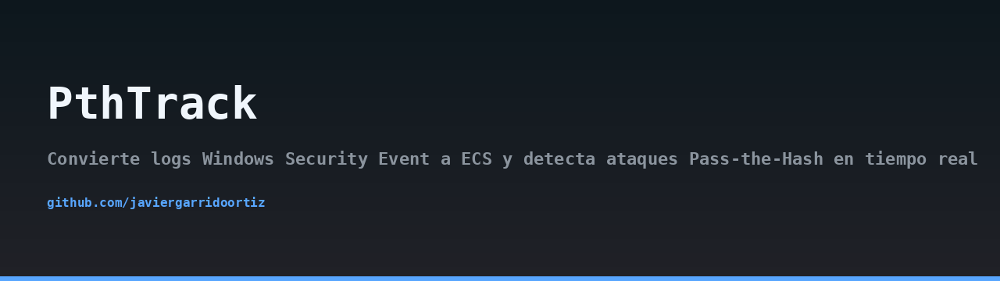
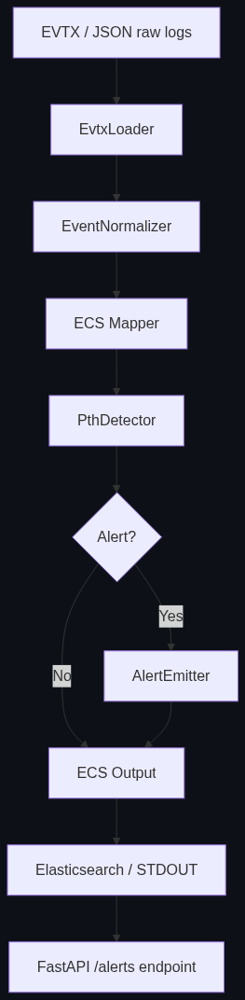
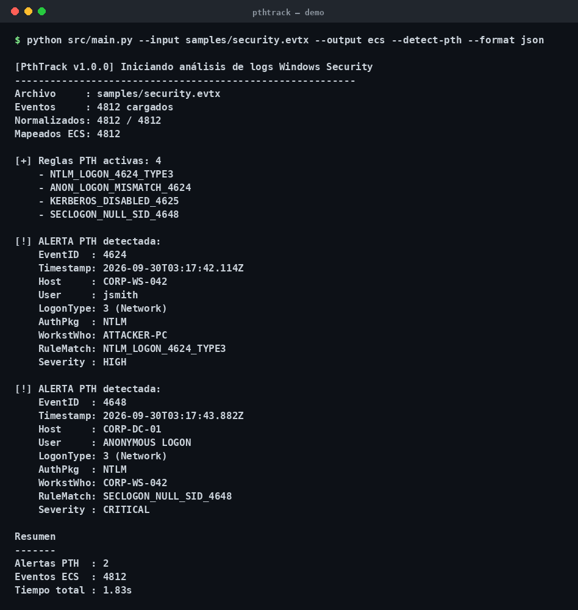

## Architecture



## Demo



> 🇪🇸 Read this in [Spanish](README.md).

# PthTrack

PthTrack converts Windows Security Event logs into the Elastic Common Schema (ECS v8) and detects Pass-the-Hash attacks in real time, based on MITRE ATT&CK technique T1550.002.

## The problem

Pass-the-Hash (PtH) is one of the most common lateral movement techniques in Windows environments. An attacker who obtains an NTLM hash (via LSASS dumping, credential theft, or a compromised host) can authenticate as the victim user without ever knowing the plaintext password. Native Windows auditing generates the necessary events (4624, 4625, 4648, 4672, 4768, 4769), but they arrive in EVTX format, with hundreds of fields, and no direct correlation between them.

A Blue Team analyst facing thousands of daily events has three options: drown in noise, build ad-hoc scripts, or rely on an expensive SIEM. PthTrack offers a fourth option: a lightweight, auditable pipeline that normalizes to ECS and applies concrete detection rules with MITRE references.

## Blue Team motivation

- Normalize once, analyze anywhere: every event ends up in ECS v8, ready for Elasticsearch, OpenSearch, or any compatible backend.
- Explicit rules, not black boxes: each detection has a name, a severity, and a documented MITRE reference.
- Fast by design: `python-evtx` for binary parsing and `orjson` for serialization.
- Testable: the detection engine is pure Python and has unit tests with synthetic events.

## Architecture

PthTrack is organized into four decoupled layers:

1. **Ingestion** (`EvtxLoader`): opens `.evtx` files with `python-evtx` or accepts raw JSON from existing pipelines. Emits one Python dict per event.
2. **Normalization** (`EventNormalizer` + `ECSMapper`): validates with Pydantic v2 models per EventID and transforms to ECS v8 fields (`host.name`, `user.name`, `event.code`, `event.action`, `source.ip`, `winlog.logon.type`, `winlog.logon.auth_package`, `@timestamp`).
3. **Detection** (`PthDetector`): rule engine based on documented patterns for T1550.002.
4. **Exposure** (`FastAPI`): REST endpoints for querying alerts and ingesting files on demand.

The CLI (`src/main.py`, based on `argparse` + `rich`) orchestrates the pipeline and can write to STDOUT, a JSON file, or index directly into Elasticsearch.

## Installation

Requires Python 3.11 or higher.

```bash
git clone https://github.com/javiergarrido/pthtrack.git
cd pthtrack
python -m venv .venv
source .venv/bin/activate
pip install -r requirements.txt
```

Copy the environment template and adjust the values:

```bash
cp .env.example .env
```

Available environment variables:

- `ES_URL`: Elasticsearch endpoint (e.g. `http://localhost:9200`).
- `ES_INDEX`: index name (default `pthtrack-alerts`).
- `ES_API_KEY`: API key if your cluster requires it.
- `PTHTRACK_LOG_LEVEL`: `DEBUG`, `INFO`, `WARNING`, `ERROR`.

No credentials are hardcoded. If `ES_URL` is not defined, the exporter falls back to STDOUT.

## CLI usage

Process a local EVTX file and print alerts to STDOUT:

```bash
python -m src.main --input samples/security.evtx --format stdout
```

Process raw JSON events and save to a file:

```bash
python -m src.main --input events.json --format json --output alerts.json
```

Index directly into Elasticsearch:

```bash
python -m src.main --input samples/security.evtx --format elastic --index pthtrack-alerts
```

Filter by minimum severity:

```bash
python -m src.main --input samples/security.evtx --min-severity HIGH
```

## Supported EventIDs

| EventID | Meaning | Relevant ECS fields |
|---------|---------|---------------------|
| 4624 | Successful logon | `user.name`, `source.ip`, `winlog.logon.type`, `winlog.logon.auth_package` |
| 4625 | Failed logon | `user.name`, `source.ip`, `winlog.logon.type`, `event.outcome` |
| 4648 | Logon with explicit credentials | `user.name`, `source.ip`, `winlog.logon.auth_package` |
| 4672 | Special privileges assigned | `user.name`, `winlog.logon.type` |
| 4768 | Kerberos TGT request | `user.name`, `source.ip`, `winlog.logon.auth_package` |
| 4769 | Kerberos service ticket request | `user.name`, `source.ip`, `winlog.logon.auth_package` |

## Detection rules (MITRE ATT&CK T1550.002)

- **PTH-NET-NTLM**: EventID 4624 with `LogonType=3` and `AuthenticationPackage=NTLM`. Severity: HIGH.
- **PTH-EXPLICIT-CREDS**: EventID 4648 with null SID in a network authentication. Severity: HIGH.
- **PTH-KERB-FALLBACK**: EventID 4625 with Kerberos failure followed by NTLM fallback from the same source IP within a 5-minute window. Severity: CRITICAL.
- **PTH-ANON-THEN-PRIV**: Anonymous logon (4624, LogonType=3) followed by EventID 4672 from the same host within 60 seconds. Severity: CRITICAL.

Reference: https://attack.mitre.org/techniques/T1550/002/

## FastAPI endpoints

Start the API:

```bash
uvicorn src.api:app --host 0.0.0.0 --port 8000
```

List paginated alerts:

```bash
curl "http://localhost:8000/alerts?limit=20&offset=0&severity=HIGH"
```

Get full ECS detail for an alert:

```bash
curl http://localhost:8000/alerts/6f1c2b3e-9d4a-4f1e-8b2a-1c7e5a9d3f10
```

Ingest a file on demand:

```bash
curl -X POST http://localhost:8000/ingest \
  -H "Content-Type: application/json" \
  -d '{"path": "samples/security.evtx", "min_severity": "HIGH"}'
```

## Demo output

The `rich` CLI prints a table with detected alerts:

```
┏━━━━━━━━━━━━━━━━━━━━━━━━━━━━━━━━━━━━━━━━━━━━━━━━━━━━━━━━━━━━━━━━━━━━━━━━━━━━┓
┃ Rule              Severity  User          Source IP      EventID  MITRE    ┃
┡━━━━━━━━━━━━━━━━━━━━━━━━━━━━━━━━━━━━━━━━━━━━━━━━━━━━━━━━━━━━━━━━━━━━━━━━━━━━┩
│ PTH-NET-NTLM      HIGH      jdoe          10.0.4.21      4624     T1550.002│
│ PTH-ANON-THEN-PRIV CRITICAL svc_backup    10.0.4.55      4672     T1550.002│
└──────────────────────────────────────────────────────────────────────────────┘
2 alerts detected (1 HIGH, 1 CRITICAL)
```

## Responsible use

PthTrack is a defensive tool intended for security teams operating on systems and logs they are authorized to analyze. Running it against third-party infrastructure without written permission may be illegal in your jurisdiction. The authors assume no liability for misuse.

## License

MIT. See [LICENSE](LICENSE) for the full text.
