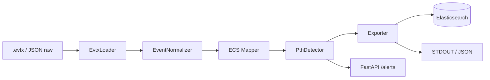

## Arquitectura


## Demo


> 🇬🇧 Read this in [English](README.en.md).

# PthTrack


PthTrack convierte los eventos de Windows Security (`.evtx`) al esquema Elastic Common Schema v8 y detecta ataques Pass-the-Hash en tiempo real mediante reglas alineadas con MITRE ATT&CK T1550.002.

## El problema

Los logs de Windows Security son ruidosos, binarios y no hablan ECS. Un analista Blue Team que quiere correlacionar un logon sospechoso con el resto de su stack (Elastic, SIEM, dashboards) tiene que parsear a mano EventID por EventID, mapear campos propietarios (`TargetUserName`, `IpAddress`, `AuthenticationPackageName`, `LogonType`...) y rezar para que el pipeline no pierda contexto. Pass-the-Hash, además, no genera un evento único: se manifiesta como una *combinación* de logons de red con NTLM, SIDs nulos y fallbacks de Kerberos a NTLM.

PthTrack automatiza esa cadena completa: abre el `.evtx`, normaliza cada evento a un modelo Pydantic v2, lo mapea a ECS v8 y aplica un motor de reglas que marca las combinaciones típicas de PtH con severidad y referencia MITRE.

## Motivación Blue Team

- **Menos tiempo en parsing, más en caza.** El analista recibe JSON ECS listo para indexar.
- **Detección explicable.** Cada alerta lleva `rule`, `severity` y `mitre_ref`, no una caja negra.
- **Integrable.** Funciona como CLI, como librería o como API REST.
- **Sin dependencias propietarias.** Todo open source, todo auditable.

## Arquitectura



Cuatro capas desacopladas: ingesta, normalización, detección y exposición. Cada una es testeable de forma independiente.

## Instalación

```bash
git clone https://github.com/javiergarrido/pthtrack.git
cd pthtrack
python -m venv .venv
source .venv/bin/activate   # Windows: .venv\Scripts\activate
pip install -r requirements.txt
```

Copia el fichero de ejemplo de configuración y rellena tus valores:

```bash
cp .env.example .env
```

Variables soportadas (todas opcionales salvo que uses Elasticsearch):

- `PTHTRACK_ELASTIC_URL` — endpoint de Elasticsearch, p. ej. `http://localhost:9200`
- `PTHTRACK_ELASTIC_INDEX` — índice destino, por defecto `pthtrack-alerts`
- `PTHTRACK_ELASTIC_API_KEY` — API key si tu clúster la exige
- `PTHTRACK_LOG_LEVEL` — `INFO`, `DEBUG`, `WARNING`

## Uso CLI

Procesar un `.evtx` y volcar alertas a STDOUT en JSON ECS:

```bash
python -m src.main --input Security.evtx --detect-pth --format json
```

Escribir el resultado a fichero:

```bash
python -m src.main --input Security.evtx --detect-pth --output alerts.json --format json
```

Indexar directamente en Elasticsearch:

```bash
python -m src.main --input Security.evtx --detect-pth \
  --elastic-url http://localhost:9200 --format ecs
```

Aceptar JSON raw ya extraído por otro pipeline:

```bash
python -m src.main --input events.json --format json --detect-pth
```

Flags principales:

| Flag | Descripción |
| --- | --- |
| `--input` | Ruta a `.evtx` o a JSON con eventos crudos |
| `--output` | Fichero de salida (si se omite, STDOUT) |
| `--detect-pth` | Activa el motor de reglas Pass-the-Hash |
| `--format` | `json` (crudo normalizado) o `ecs` (ECS v8) |
| `--elastic-url` | Endpoint Elasticsearch para indexado directo |

## EventIDs cubiertos

| EventID | Descripción | Relevancia PtH |
| --- | --- | --- |
| 4624 | Logon exitoso | Alto: LogonType 3 + NTLM es firma clásica |
| 4625 | Logon fallido | Medio: fallback Kerberos→NTLM tras intento fallido |
| 4648 | Logon con credenciales explícitas | Alto: SID nulo en red indica uso de hash |
| 4672 | Privilegios especiales asignados | Alto: confirma escalada tras PtH |
| 4768 | TGT solicitado (Kerberos) | Medio: ausencia + NTLM sugiere bypass |
| 4769 | Ticket de servicio solicitado | Medio: contexto de movimiento lateral |

## MITRE ATT&CK

- **T1550.002 — Use Alternate Authentication Material: Pass the Hash.** Técnica principal que PthTrack detecta.
- **T1078 — Valid Accounts.** El atacante reutiliza cuentas legítimas con hashes robados.
- **T1021 — Remote Services.** Movimiento lateral vía SMB/WinRM tras el PtH.

Cada alerta incluye el campo `mitre_ref` con el identificador de la técnica para trazabilidad directa en tu SIEM.

## API REST

Arranca el servidor:

```bash
uvicorn src.api:app --host 0.0.0.0 --port 8000
```

Listado paginado de alertas:

```bash
curl "http://localhost:8000/alerts?limit=20&offset=0"
```

Detalle de una alerta por ID:

```bash
curl http://localhost:8000/alerts/6f1c2e9a-3b4d-4a1e-9c2f-8a7b6c5d4e3f
```

Ingesta bajo demanda:

```bash
curl -X POST http://localhost:8000/ingest \
  -H "Content-Type: application/json" \
  -d '{"path": "/var/log/evtx/Security.evtx", "detect_pth": true}'
```

## Salida de ejemplo

```
$ python -m src.main --input Security.evtx --detect-pth --format ecs
[12:04:11] INFO  Cargando Security.evtx (2.3 MB)
[12:04:12] INFO  1842 eventos leídos
[12:04:12] INFO  1842 eventos normalizados
[12:04:12] WARN  3 alertas Pass-the-Hash detectadas
{
  "@timestamp": "2024-11-08T12:04:12.114Z",
  "event": {"code": "4624", "action": "logon-success", "kind": "event"},
  "host": {"name": "DC01.corp.local"},
  "user": {"name": "svc_backup"},
  "source": {"ip": "10.0.4.77"},
  "winlog": {
    "logon": {"type": 3, "auth_package": "NTLM"}
  },
  "pthtrack": {
    "rule": "ntlm_network_logon",
    "severity": "HIGH",
    "mitre_ref": "T1550.002"
  }
}
```

## Uso responsable

PthTrack analiza logs. No ataca nada, no inyecta tráfico y no modifica sistemas. Aun así, trátalo con cuidado:

- Úsalo **solo** sobre ficheros `.evtx` de sistemas propios o para los que tengas autorización escrita.
- No publiques alertas con datos personales sin anonimizar.
- Si lo integras en un SOC, revisa las reglas y ajústalas a tu baseline antes de activar severidades CRITICAL.

El autor no se responsabiliza de usos indebidos.

## Licencia

MIT. Consulta el fichero [LICENSE](LICENSE).

Autor: **Javier Garrido Ortiz**.
